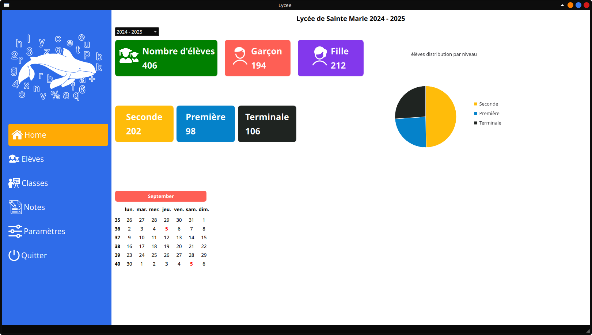
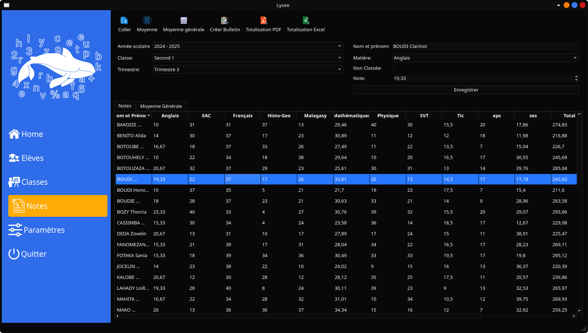

# Lycee

Lycee is a desktop student-management application focused on grade averages and
transcript creation. It was initially developed for a local high school in
Madagascar.




## Requirements

- CMake 3.16 or newer
- A C++17 compiler
- Qt 5 or Qt 6 with Core, GUI, Widgets, SQL, Quick Widgets, and Print Support;
  the Test module is also needed when building the test suite
- Git, for retrieving the xlnt submodule and its recursive dependencies
- `wkhtmltopdf` on `PATH` to create PDF exports at runtime

## Clone

Clone the repository and all nested dependencies in one command:

```sh
git clone --recurse-submodules <repository-url> lycee
cd lycee
```

For an existing checkout, initialize or refresh the dependencies with:

```sh
git submodule update --init --recursive
```

The [`self-root/xlnt`](https://github.com/self-root/xlnt) fork lives in the
`xlnt` submodule. CMake builds it as a static library automatically; no
prebuilt `libxlnt` file or separate xlnt installation is required.

## Configure and build

Point `CMAKE_PREFIX_PATH` at the Qt kit that matches your compiler:

```sh
cmake -S . -B build -DCMAKE_PREFIX_PATH=/path/to/Qt/6.x.x/your_kit
cmake --build build --parallel
```

On Windows with Qt's MinGW kit and Ninja, for example:

```powershell
cmake -S . -B build -G Ninja `
  -DCMAKE_PREFIX_PATH=C:/Qt/6.x.x/mingw_64 `
  -DCMAKE_C_COMPILER=C:/Qt/Tools/mingwXXXX_64/bin/gcc.exe `
  -DCMAKE_CXX_COMPILER=C:/Qt/Tools/mingwXXXX_64/bin/g++.exe
cmake --build build --parallel
```

Qt Creator can also open the root `CMakeLists.txt` directly and configure it
with any installed desktop kit.

## Tests

Tests are enabled by default:

```sh
ctest --test-dir build --output-on-failure
```

Pass `-DLYCEE_BUILD_TESTS=OFF` while configuring to omit the application test
target. xlnt's own samples, benchmarks, tests, and Python bindings remain
disabled in normal application builds.
